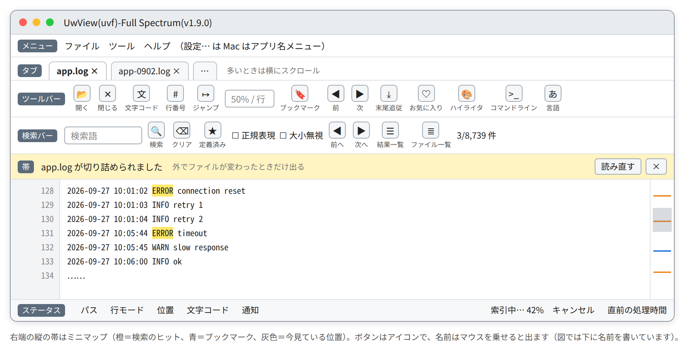

# UwView

*日本語 ｜ [English](README.en.md)*

**CLI で探して、GUI で読む。巨大なログ・テキストを調べるための CLI／GUI ツールです。**

**CLI（`uvf`）は ripgrep と同等の速さで探し、GUI は klogg と同等の速さで開きます。** 違うのは、その2つが**1回でつながる**ことです。`uvf ファイル '語' -open` と打てば、探し終えた瞬間に GUI が開き、ヒットした行が並びます。**GUI はもう一度探しません。**

📥 **[ダウンロード（無料）](https://github.com/amru195704/UwView/releases/latest)** ・ 🌐 **[公式サイト](https://uvp.y42u.net/)** ・ 🧪 **[ブラウザで試す](https://amru195704.github.io/UwView/)**  
📖 **[uvf コマンド操作マニュアル](2-doc/uvf_コマンド操作マニュアル.md)** ・ 🖥 **[GUI の操作マニュアル](2-doc/UwView_操作マニュアル.md)**（[PDF](2-doc/UwView_操作マニュアル.pdf)） ・ 🧾 **[v1.9.0 リリースノート](https://github.com/amru195704/UwView/releases/tag/v1.9.0)**  
▶ **[動画で見る（YouTube・日本語）](https://www.youtube.com/playlist?list=PLVa-Z1XEnkKs)** ・ [English](https://www.youtube.com/playlist?list=PLBJs4svTLd_w) ・ [チャンネル @uwviewapp](https://www.youtube.com/@uwviewapp)

> **最新版は v1.9.0「Full Spectrum」。** 無料版でも **Word・Excel・PDF の中の文字を探せる**ようになり、ダークテーマ・フォント・キーの割り当て（vi・less 風）、結果一覧へのブックマーク、ファイル指定の波かっこ `{a,b}` が入りました（[リリースノート](https://github.com/amru195704/UwView/releases/tag/v1.9.0)）。
> 前の版 v1.8.1.9「Finder Scope」で、画面に「コマンドライン」が入り、`uvf` と同じ書き方で画面から検索できるようになりました。
> 複数のファイルを、ワイルドカード1つでまとめて探せます。平文と **7 種類の圧縮ファイル**（gz・bz2・xz・lzma・zst・lz4・br）を混ぜても1回で済み、外部のコマンドは要りません。
> v1.7.3.6.9 では、キャッシュに載ったファイルの2回目の検索が ripgrep 以上になりました。mac・Windows・Linux の3つの OS で確かめています（[3つの OS の結果](#3つの-os-で測った結果)）。

---

## 数字で見る UwView

| こんなとき | 相手 | **UwView** |
|---|---|---|
| **圧縮したログを探す**（7 形式・979MB） | ugrep・ripgrep と**同等**／標準の grep（zgrep など）より **最大 2.73 倍速い** | **`uvf` が 7 形式すべてで最短** |
| **gz を 12 本・約 60GB 分まとめて探す** | zgrep 89.35 秒 | **`uvf` 17.60 秒（zgrep より 5.08 倍速い）** |
| **50GB を探して、ヒットした場所を GUI で読む** | klogg（開く＋検索）108.1 秒 | **`uvf … -open` 50.76 秒（klogg より 2.13 倍速い）** |
| **258GB・45 億行を探して GUI へ** | klogg は開き終わるだけで 258 秒 | **`uvf … -open` 261.37 秒**で、探し終えて一覧まで出る |

**表の数字は、すべて無料版（`uvf` と GUI）のものです。** 有料版の [UwView Pro](https://uvp.y42u.net/pro/) もあります（14 日間の無料試用あり）。

**先に負けを書きます。**

- **小さなファイルが大量にある場所では、ripgrep の方が少し速い**です（Linux カーネルのソース 8.6 万本・5 種類の検索の合計で `uvf` は ripgrep の 1/1.20。1.5 倍未満なので同等の範囲です）。
- **Windows では、圧縮ファイルの一部の形式で ripgrep の方が速い**結果でした（xz・zst・lz4 で 1/1.5〜1/2.1。mac・Linux では同等以上）。原因は調べている途中です。

> 1.5 倍未満の差は「同等」と書き、差とは呼びません。秒数は 1 台の Mac の値です（条件は[ページの最後](#数字の条件)）。**環境をまたいで秒数を比べないでください。**

---

## CLI：ripgrep・grep 系と比べる

### 圧縮したログを、そのまま探す（7 形式）

同じ 979MB のテキストを 7 形式で圧縮し、「東京」を探しました（hot・秒）。**出力の行数と中身は、すべての道具で `uvf` と一致**しています。

| 形式 | 標準の grep（秒） | ugrep 7.8.5（秒） | ripgrep 15.2.0（秒） | **`uvf`**（秒） |
|---|---:|---:|---:|---:|
| gz | 0.90（zgrep） | 0.45 | 0.43 | **0.33** |
| bz2 | 8.03（bzgrep） | 7.62 | 7.89 | **7.43** |
| xz | 4.01（xzgrep） | 3.64 | 4.21 | **3.37** |
| lzma | 3.21（xzgrep） | 2.83 | 3.40 | **2.57** |
| zst | 0.63（zstdgrep） | 0.65 | 0.54 | **0.50** |
| lz4 | 0.65（lz4 -dc｜grep） | 0.33 | 0.31 | **0.28** |
| br | 1.33（brotli -dc｜grep） | 0.91 | 0.87 | **0.74** |

- **1回だけ探すなら `uvf` が 7 形式すべてで最短**です。ただし ugrep・ripgrep との差は 1.03〜1.36 倍で、**同等**です。
- **標準の grep には差がつきます**：gz で **2.73 倍**、lz4 で **2.32 倍**、br で **1.80 倍**（bz2・xz・lzma・zst は同等）。
- `uvf` は**外部のコマンドを呼びません**。`rg -z` は形式ごとに gzip・xz などを呼ぶので、そのコマンドが無い環境では黙って飛ばします。
- ag（The Silver Searcher）は、4 形式を展開できず、展開後 2GB を超えるファイルで落ちたため、比べる相手から外しました。

### 複数のファイルを、まとめて探す

| hot | zgrep（秒） | ugrep（秒） | ripgrep（秒） | **`uvf`**（秒） |
|---|---:|---:|---:|---:|
| gz 5 本（展開後 約 7.4GB） | 9.43 | 2.56 | 1.34 | **1.04** |
| gz 7 本＋平文 5 本＝12 本（展開後 約 60GB） | 89.35 | 25.38 | 24.62 | **17.60** |

- 12 本で、`uvf` は **zgrep の 5.08 倍**。ugrep・ripgrep とは同等（1.44 倍・1.40 倍）です。キャッシュを捨てた cold でも、`uvf` 21.35 秒・ugrep 26.85 秒と同等でした。

```bash
uvf '*.log' ERROR                    # 今のフォルダーの .log をまとめて
uvf '**/*.log' ERROR -open           # サブフォルダーも含めて探し、結果を GUI へ
uvf 'app.log,app.log.*.gz' ERROR     # 平文と圧縮を混ぜて、1回で
```

外すファイルは **ripgrep と同じ規則**です（`.ignore`・`.gitignore`・隠しファイル。外したくないときは `--no-ignore`）。

### 1本の大きなファイル

素の検索「東京」（秒・cold＝キャッシュを捨てた直後／hot＝続けて2回目）

| 1回目（cold）／ 2回目（hot） | ripgrep 15.2.0（秒） | **`uvf`**（無料・秒） |
|---|---:|---:|
| 3GB | 3.26 ／ 0.31 | **3.04 ／ 0.29** |
| 10GB | 10.94 ／ 0.97 | **10.15 ／ 0.88** |
| 50GB | 64.68 ／ 70.33 | **50.66 ／ 55.94** |

**`uvf` はどの大きさでも、1回目も2回目も ripgrep と同等以上**です（v1.7.3.6.9 で、行番号のために改行を数える処理を 5 倍速くし、2回目も ripgrep を上回りました）。50GB では、ファイルがメモリに収まらないので、ripgrep も `uvf` も2回目が速くなりません（ripgrep の2回目は、測るたびに 55〜70 秒とぶれます）。

検索 7 種（素・`-i`・`-E`・`-E` 行頭・`-E -i`・`-v`・`-E -v`）の cold＋hot 合計：

| | ripgrep（秒） | **`uvf`**（秒） |
|---|---:|---:|
| 3GB | 33.63 | 33.55（同等・1.00 倍） |
| 10GB | 95.41 | 81.99（同等・ripgrep より 1.16 倍速い） |
| 50GB | 870.64 | 768.93（同等・ripgrep より 1.13 倍速い） |

**結果の不一致は 0 件**です。

### 小さなファイルが大量にある場所

Linux カーネルのソース（86,602 本・平均 約 22KB）を `uvf 'src/linux/**' 語 -H` で探しました。5 種類の検索（ヒット 0〜38,253 行）の合計・秒です。

| | 1回目（cold・秒） | 2回目（hot・秒） | 合計（秒） |
|---|---:|---:|---:|
| ripgrep 15.2.0 | 22.76 | 7.47 | 30.22 |
| **`uvf`**（無料） | 26.49 | 9.72 | 36.21（ripgrep の方が 1.20 倍速い・同等） |

ここは **ripgrep が少し速い**ところです（1.5 倍未満なので同等の範囲）。v1.7.3.6.5 では2回目が ripgrep の約 18 倍、v1.7.3.6.8 でも約 2.2 倍かかっていました。

### 3つの OS で測った結果

**v1.9.0「Full Spectrum」（2026-10-14）**

Mac で v1.9.0 を測った、いちばん新しい結果です（2026-10-14・Apple M4・メモリ 32GB・外付け USB SSD）。倍率は ripgrep の秒数 ÷ `uvf` の秒数（cold＋hot の合計）で、1.5 倍未満は同等です。

Windows・Linux でも同じテスト一式を流し、**正常に動くこと**を確かめました（正しさのテスト：入力の種類 66 件・複数ファイル 34〜36 件・除外 43 件がすべて合格、速さの段の出力も ripgrep と不一致 0）。Windows・Linux の速さは、機械も条件も Mac と違うので**参考値**として右の 2 列に載せます。

| ripgrep ÷ uvf（cold＋hot の合計） | **Mac** | Windows（参考） | Linux（参考） |
|---|---:|---:|---:|
| 無料版 `uvf`・検索 7 種（3GB／10GB） | **1.08／1.08**（同等） | 1.46／1.92 | 1.32／1.06 |
| 出力の突き合わせ | **不一致 0** | 不一致 0 | 不一致 0 |

詳しくは [v1.9.0「Full Spectrum」の記事](https://uvp.y42u.net/blog/uwview-v190-full-spectrum/)。

**前回（v1.7.3.6.8〜9・2026-10-04）**


同じテスト一式を、mac・Windows・Linux で流しました。**正しさのテスト（入力の種類 66 件・複数ファイル 36 件・除外 43 件）は3つとも合格、速さの比較でも結果の不一致は 0 件**です。数字は ripgrep との比（1 超＝`uvf` が速い）で、**秒は OS をまたいで比べません**。

| ripgrep より何倍速いか | mac（倍） | Windows（倍） | Linux（倍） |
|---|---|---|---|
| 機械 | Apple M4・10 コア・32GB | x64・8 論理コア・16GB | aarch64・**2 論理コア**・7GB |
| `uvf` 大きい1本・7 つの検索（3GB／10GB／50GB） | 1.00／1.16／1.13 | 1.48／1.90／**2.47** | 1.31／1.13／1.33 |
| `uvf` 複数ファイル（平文 5 本／gz 7 本／混在 12 本） | 1.02／1.31／1.29 | 1.86／1.54／1.58 | 2.22／1.67／1.67 |

- **Windows と Linux では、mac より差が大きく出ます。** Windows は ripgrep の1回目が遅く、Linux（2 コア）は `rg -z` が外部の展開コマンドを呼ぶ分が効きます。
- **弱いところ**：Windows の `uvf` は、圧縮の xz・zst・lz4 で ripgrep より 1.5〜2.1 倍遅い結果でした。
- Windows・Linux は 1.7.3.6.8 で測りました（1.7.3.6.9 との違いは、小さなファイルが大量にある場所の検索だけです）。

> **Windows で `rg` を使っている方へ:** 50GB では `--no-mmap` を付けると **2.89 倍**速くなります → **[検証記事](https://uvp.y42u.net/blog/uvp-rg-no-mmap-50gb/)**

---

## GUI：klogg と比べる

| cold | 3GB（秒） | 10GB（秒） | 50GB（秒） |
|---|---:|---:|---:|
| **開く**：klogg 24.11.0 | 3.65 | 10.98 | 52.55 |
| **開く**：**UwView GUI** | **2.99** | **10.13** | **50.44** |
| **検索**：klogg | 0.56 | 11.75 | 55.59 |
| **検索**：**UwView GUI** | **0.32**（klogg より 1.75 倍速い） | **10.15** | **53.50** |
| **探して読むまで**：klogg（開く＋検索） | 4.21 | 22.73 | 108.1 |
| **探して読むまで**：**`uvf … -open`** | **3.40** | **10.42（klogg より 2.18 倍速い）** | **50.76（klogg より 2.13 倍速い）** |

**開くのも検索も、klogg と同等**です（3GB の検索だけ 1.75 倍）。**差がつくのは「探して、読む」まで**。klogg はファイルを開くときに1回、検索でもう1回読みます。**`uvf … -open` は、探しながら1回読むだけ**です。

**GUI で「開くだけ」と、`uvf … -open` で「探して GUI に渡すまで」の差は、+0.41／+0.29／+0.32 秒。** ファイルが 17 倍になっても、探すぶんの上乗せは 0.3〜0.4 秒のままです。コマンドが終わってから GUI に結果一覧が出るまでは **0.03〜0.08 秒**。GUI は、受け取った位置を並べるだけだからです。

### 258GB でも、開いた瞬間から末尾を見られます

klogg は**索引ができるまで末尾へスクロールできません**。258GB では **4分18秒**、その間は先頭付近しか見えません。UwView は**先に全域を動けるようにしてから**、索引を裏で作ります。

| 258.68GB・45 億行 | 末尾まで行けるまで | GUI に出ているもの |
|---|---|---|
| klogg 24.11.0 | **4分18秒** | 索引ができるまで先頭付近だけ |
| **UwView（無料）** | **待たない** | 本文（行番号は索引ができてから・開き終わるまで 4分15.5秒） |

マウスホイールでも、スクロールバーのドラッグでも、`Cmd/Ctrl+End` でも、開いた直後から末尾まで行けます。行番号へのジャンプは、ファイルの大きさによらず体感で即時です（8.9 億行で 0.003ms）。



*GUI の構成（図）。検索のヒットは右端のミニマップにも出ます。詳しくは [GUI の操作マニュアル](2-doc/UwView_操作マニュアル.md)。*

---

## 有料版（UwView Pro）

同じファイルやログに何度も戻る使い方には、有料版の **[UwView Pro](https://uvp.y42u.net/pro/)** があります（14 日間の無料試用あり）。機能と価格は製品ページをご覧ください。

---

## インストール

**Mac（Homebrew）**
```bash
brew install --cask amru195704/uwview/uwview
```
**Windows（Scoop）**
```powershell
scoop bucket add uwview https://github.com/amru195704/scoop-uwview
scoop install uwview
```
**Linux・手で入れる場合**は [GitHub Releases](https://github.com/amru195704/UwView/releases/latest) から dmg／zip／tar.gz を。

Homebrew と Scoop は、どちらも公式の GitHub Releases から取得して SHA256 を照合します。**`uvf` コマンドもそのまま使えます。**
更新は `brew upgrade --cask uwview` ／ `scoop update uwview`。

---

## 使い方

```bash
uvf japan-latest.osm '東京' -open    # 探して、そのまま GUI で読む
uvf app.log.zst ERROR                # 圧縮ファイルは展開しながら探す（7 形式）
uvf '**/*.log' ERROR --files         # 探さずに、対象になるファイルだけを出す
```

**探し終えた瞬間に GUI が開き、行番号つきの結果一覧が出ます。** あとは、前後の行を読む・一覧からジャンプする・複数のキーワードを色分けする・条件を変えて探し直す——調べる作業は、この行き来でできています。複数のファイルの結果は、ファイル一覧から追加のタブ（最大 8 個）でも開けます。

書き方・オプション・正規表現・終了コード・ripgrep との対応表は **[uvf コマンド操作マニュアル](2-doc/uvf_コマンド操作マニュアル.md)**、
GUI の使い方（検索・結果一覧・ファイル一覧とタブ・ハイライタ・キー操作）は **[GUI の操作マニュアル](2-doc/UwView_操作マニュアル.md)**（[PDF](2-doc/UwView_操作マニュアル.pdf)）にあります。

---

## どれを使えばいいか

| やりたいこと | 使うもの |
|---|---|
| **CLI で探すだけ** | **`uvf`**（無料）— ripgrep と同等 |
| **複数のファイル・圧縮したログ・いろいろな文字コードのファイルをまとめて探す** | **`uvf '*.log' 語`**（無料・圧縮 7 形式・docx・xlsx・pdf。文字コードは UTF-8・Shift-JIS・EUC-JP・UTF-16 を自動で見分ける） |
| **zip・pbf（OSM）を探す** | 有料版の **[UwView Pro](https://uvp.y42u.net/pro/)** |
| **CLI で探して、ヒットした場所を GUI で読む** | **`uvf … -open`**（無料）— **いちばん短い道** |
| **GUI で開いて眺める** | **UwView の GUI**（無料）— 開いた瞬間から末尾までスクロールできる |
| **同じファイル・同じログに何度も戻る** | 有料版の **[UwView Pro](https://uvp.y42u.net/pro/)** |
| 巨大ファイルを**書き換える** | **UwView Pro ＋ Edit Upgrade** |
| 〜3GB・インストールしたくない | **[ブラウザ版](https://amru195704.github.io/UwView/)** |

**`uvf` も GUI も無料版に入っています。** 単体実行ファイル・インストーラ不要・Windows / macOS / Linux 共通。

---

## 主な機能

**CLI（`uvf`）**：`-i`・`-E`・`-v`・終了コード 0／1／2（ヒットあり／なし／エラー。grep と同じ）・`-open`・`--json`・`--files`・`--tune`／
**複数ファイルをまとめて検索**（ワイルドカード・`**`・カンマ区切り・`.ignore`／`.gitignore` は ripgrep と同じ規則）／
**圧縮ファイル 7 形式をそのまま検索**（gz・bz2・xz・lzma・zst・lz4・br。外部コマンド不要・平文と混ぜても1回）

**GUI**：**実測最大 258.68GB・45 億行**（無料版で到達）／開いた瞬間から末尾までスクロール／検索結果一覧（元の行番号つき・ジャンプ・前後の文脈・保存）／
複数ファイルの結果を読む（ファイル一覧・最大 8 タブ）／複数キーワードの色分け（32 色・プリセット 7 種・`.uwvhl`）／ミニマップ／
文字コード自動判定（UTF-8・Shift-JIS・EUC-JP・UTF-16）／リアルタイム Tail／マルチタブ・ブックマーク・横スクロール・セッション復元／全 OS 同一描画

**動作環境**: .NET 10 ／ Avalonia UI 12.x ／ Windows・macOS・Linux

**既知の制限**：圧縮ファイルの中に **1 行が 64MiB を超える行**があり、その行が検索に一致すると、検索が止まることがあります（ファイルは壊れていません）。速度を優先するため対応の予定はありません。該当するファイルは展開してから開いてください。

---

## もっと詳しく

| | |
|---|---|
| 📖 **uvf コマンド操作マニュアル** | [2-doc/uvf_コマンド操作マニュアル.md](2-doc/uvf_コマンド操作マニュアル.md)（書き方・オプション・圧縮・正規表現・終了コード・ripgrep との対応表・性能） |
| 🖥 **GUI の操作マニュアル** | [2-doc/UwView_操作マニュアル.md](2-doc/UwView_操作マニュアル.md) ・ [PDF](2-doc/UwView_操作マニュアル.pdf)（GUI の構成・検索・結果一覧・ファイル一覧とタブ・ハイライタ・キー操作） |
| 🧾 **v1.9.0 Full Spectrum のリリースノート** | [v1.9.0](https://github.com/amru195704/UwView/releases/tag/v1.9.0)（前の版 [v1.8.1.9](https://github.com/amru195704/UwView/releases/tag/v1.8.1.9)・[v1.7.3.7](https://github.com/amru195704/UwView/releases/tag/v1.7.3.7)・[v1.7.3.6.9](https://github.com/amru195704/UwView/releases/tag/v1.7.3.6.9)・[v1.7.3.6.7](https://github.com/amru195704/UwView/releases/tag/v1.7.3.6.7)・[v1.7.3.6](https://github.com/amru195704/UwView/releases/tag/v1.7.3.6)） |
| ▶ **動画（YouTube）** | [再生リスト「UwView:日本語」](https://www.youtube.com/playlist?list=PLVa-Z1XEnkKs) ・ [English](https://www.youtube.com/playlist?list=PLBJs4svTLd_w) ・ [チャンネル @uwviewapp](https://www.youtube.com/@uwviewapp)（v1.7.3.6 の使い方 全8テーマと、まとめの1本） |
| 📊 **実測の全データと条件** | [ベンチマーク一覧](https://uvp.y42u.net/benchmarks/)（EmEditor・klogg・010 Editor・UltraEdit・Log Viewer・grep・ripgrep・amber を 3GB〜250GB で実測。**負けている数字もそのまま載せています**） |
| 📖 **klogg と正直に比べ直した話** | [記事](https://uvp.y42u.net/blog/uvp-klogg-open-lose-flow-win/) |
| 📖 **同じ 50GB を 3 つの土俵で測った** | [記事](https://uvp.y42u.net/blog/uvp-three-arenas-50gb/) |
| 📖 **ログの圧縮形式の選び方（7 形式を実測）** | [記事](https://uvp.y42u.net/blog/log-compression-format-choice/) |
| 📖 **ripgrep の `--no-mmap`** | [記事](https://uvp.y42u.net/blog/uvp-rg-no-mmap-50gb/) |
| 📰 **プレスキット** | [PRESSKIT.md](press-kit/PRESSKIT.md) |

---

## 数字の条件

- **機械**：MacBook Air（Apple M4・10 コア・メモリ 32GB）・外付け USB SSD。データは OpenStreetMap（日本）の XML、語は「東京」。**秒数は環境によって変わります。環境をまたいで秒数を比べないでください。**
- **CLI・1本の大きなファイル・小さなファイルが大量にある場所**：`uvf` 1.7.3.6.9・ripgrep 15.2.0・2026-10-04。cold＝キャッシュを捨てた直後（`sudo purge`＋10 秒待ち）、hot＝続けて2回目。
- **3つの OS**：mac は上と同じ。Windows（x64・8 論理コア・15.6GB）と Linux（aarch64・2 論理コア・7.0GB）は `uvf` 1.7.3.6.8・ripgrep 15.2.0（Linux は 15.1.0）・2026-10-03。Windows の `uvf` はスレッドが設定で 4 本でした。
- **CLI・圧縮 7 形式と複数ファイル**：`uvf` 1.7.3.4（検索の処理は v1.7.3.6 と同じ）・ugrep 7.8.5・ripgrep 15.2.0・macOS 標準の zgrep／bzgrep／xzgrep／zstdgrep・2026-09-28。**hot**（各 2 回の速い方）。12 本の cold だけは別計測。すべての測定で、出力の行数と中身を突き合わせています。平文 5 本の比較だけは `uvf` 1.7.2.7（cold＋hot）。
- **GUI と klogg**：最新の比較は v1.6.6・klogg 24.11.0・2026-09-20・cold。258GB は v1.6.6・2026-09-21。
- 1.5 倍未満の差は「同等」と書いています。

---

## 支援について

**UwView（無料版）は、これからも無料のままです。** 個人利用も、会社の中での業務利用も無料です。

もし役に立って、続いてほしいと思っていただけたら [GitHub Sponsors](https://github.com/sponsors/amru195704) からどうぞ。**任意です。**
**お金よりも助かるのは**、うまく動かなかった報告（どんなファイルで、どう困ったか）と、**手元の巨大ファイルで測った結果**です
——**負けていた、という報告が特にありがたいです** → [Issues](https://github.com/amru195704/UwView/issues)

開発資金は主に [UwView Pro](https://uvp.y42u.net/pro/) の売上でまかなっています。**Pro を買っていただくのが、いちばん直接的な支援です。**

## ライセンス

[PolyForm Internal Use License 1.0.0](LICENSE)。**個人利用・企業の社内業務利用は無料**です。
**再配布・製品/サービスへの組込み・転売・第三者への提供はできません**（別途「商用（再配布）ライセンス」が必要です → [Issues](https://github.com/amru195704/UwView/issues)）。
ただし、**公式バイナリを無改変のままパッケージとして再配布することはできます**（下記）。
日本語の参考訳: [LICENSEjp.txt](LICENSEjp.txt)（正文は英語版）

> **パッケージ化・パッケージマネージャへの登録について**
> **Homebrew・Scoop・winget などのマニフェストから、公式の配布物（[GitHub Releases](https://github.com/amru195704/UwView/releases/latest)）を
> 参照する形は、再配布にあたりません。** 利用者の環境が公式の配布元から直接ダウンロードするためです。
> **こうした登録・PR は歓迎します。** マニフェストに記載するハッシュは、各リリースに添付している `SHA256SUMS` をお使いください。
> **それに加えて、公式バイナリを無改変のまま写しとして置くパッケージ（Flathub・Snap・AUR・ディストリビューションのリポジトリなど）も歓迎します。**
> 条件は [LICENSE](LICENSE) の「Additional Permission」（参考訳は [LICENSEjp.txt](LICENSEjp.txt) の「追加の許可」）にあります。要点は、公式の配布ファイルを改変しないこと（展開・配置・デスクトップエントリやアイコンの追加は可）、
> 各リリースに添付している `SHA256SUMS` とハッシュが一致すること、LICENSE を同梱するかリンクしてオープンソースではないと明記すること、作者公認と誤解させないこと、ソフトそのものに料金を取らないこと、です。
> ソースからのビルド・改変したバイナリ・他の製品への組込みは対象外で、別途ご相談ください。

## 作者の関連プロダクト

測量士・土地家屋調査士向けの iOS アプリ群（同じ作者 y4u。UwView とは独立した製品です）:
**[GeoConverter Pro](https://gcpro.y42u.net/)**（座標変換）・**[GeoPrism JP](https://gmp.y42u.net/)**（測地系のズレの可視化）・**[GeoDiveExa](https://y42u.net/tec001/)**（RTK-GNSS 位置調査）
